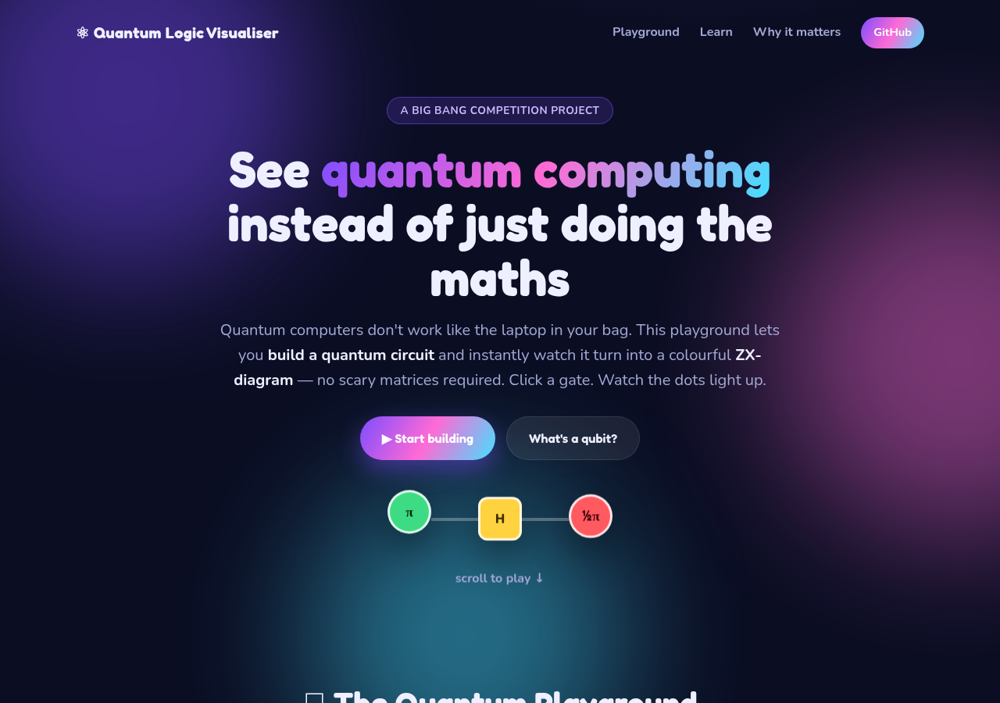
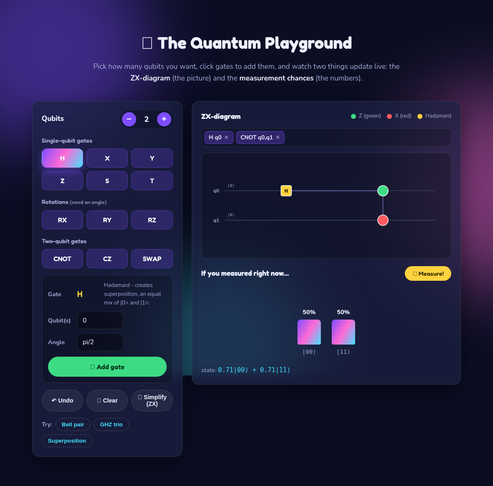
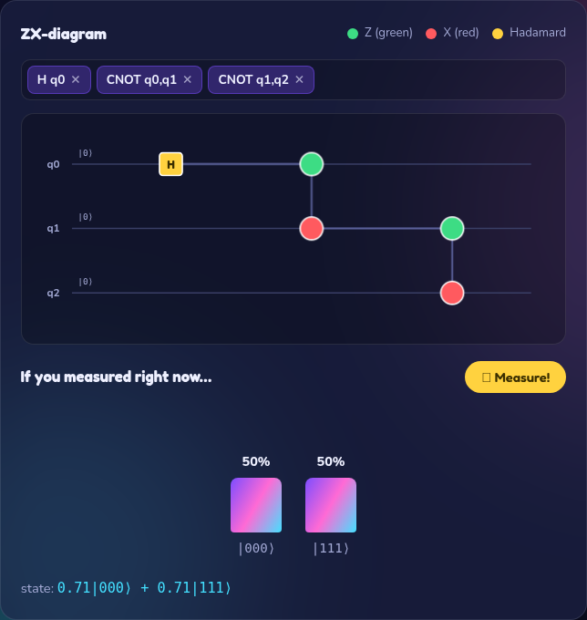

# ⚛ Quantum Logic Visualiser

**See quantum computing instead of just doing the maths.**

An open-source educational tool that turns quantum circuits into colourful
**ZX-diagrams** — built to make quantum computing approachable, visual and fun
for high-school students.

Created by **Valentina Carmignani** for the Big Bang Competition.

[](LICENSE)




---

## What is this?

Quantum computing is usually taught with heavy linear algebra — matrices,
complex numbers and tensor products that scare a lot of students away before
they ever see the beauty of the ideas.

This project takes a different route. Based on **Bob Coecke's _Quantum
Picturalism_** and the **ZX-calculus**, it lets you *build a quantum circuit by
clicking gates* and instantly watch it become a diagram of green and red dots
("spiders") joined by wires. Alongside the picture it shows the **real
measurement probabilities**, so the abstract diagram is always tied to
something concrete.

There are two versions in this repository:

| | What | Best for |
|---|---|---|
| 🌐 **Web app** (`web/`) | Runs in any browser, nothing to install | Classrooms, phones, sharing a link |
| 🖥️ **Desktop app** (`desktop/`) | A Python + Tkinter program | Tinkering with the code, offline use |

Both are powered by the same, fully **unit-tested** quantum engine.

---

## ✨ Try it now (web version)

👉 **Live demo:** `https://ValentinaCarmignani.github.io/quantum-logic-visualiser/`
_(goes live once GitHub Pages is enabled — see [PUBLISHING.md](PUBLISHING.md))_

Or run it locally — it's just static files:

```bash
cd web
python -m http.server 8000      # then open http://localhost:8000
```

### What you can do
- Add **all the essential gates**: H, X, Y, Z, S, T, RX, RY, RZ, CNOT, CZ, SWAP
- Watch the **ZX-diagram** build itself, spider by spider
- See **live measurement probabilities** as animated bars
- Hit **🎲 Measure!** to collapse the superposition to a single answer
- Press **✨ Simplify** to watch ZX *spider-fusion* tidy the diagram
- Load one-click examples: **Bell pair**, **GHZ trio**, **Superposition**

| Build a Bell pair | Watch a GHZ state |
|---|---|
|  |  |

---

## 🖥️ Desktop version (Python)

```bash
cd desktop
pip install -r ../requirements.txt     # just numpy
python app.py
```

> `tkinter` ships with the standard Python installer on Windows and macOS.
> On Linux run `sudo apt install python3-tk` if it's missing.

The desktop app has the same gate palette, animated ZX-diagram, live
probability chart and a ZX-simplify toggle.

---

## 🕸️ How ZX-calculus works (the 30-second version)

ZX-calculus draws quantum programs as graphs instead of matrices. There are
only three kinds of node:

| Node | Colour | Meaning |
|---|---|---|
| **Z-spider** | 🟢 green | a rotation around the qubit's Z axis |
| **X-spider** | 🔴 red | a rotation around the qubit's X axis |
| **Hadamard** | 🟡 yellow | the "H box" that swaps the Z and X worlds |

Each spider can carry a **phase** (an angle), and wires show how information
flows. That tiny toolkit is enough to express *any* quantum computation.

Familiar gates translate like this:

| Gate | ZX-diagram |
|---|---|
| `Z` | one green spider, phase π |
| `X` | one red spider, phase π |
| `S` / `T` | one green spider, phase π/2 / π/4 |
| `RZ(θ)` / `RX(θ)` | one green / red spider, phase θ |
| `H` | one yellow Hadamard box |
| `CNOT` | a green (control) spider joined to a red (target) spider |
| `CZ` | two green spiders joined by a Hadamard edge |
| `SWAP` | the two wires cross over |

---

## 📁 Project structure

```
quantum-logic-visualiser/
├── web/                     🌐 browser version (GitHub Pages)
│   ├── index.html
│   ├── style.css
│   ├── quantum-engine.js     ZX + simulator, ported to JavaScript
│   └── app.js                page interactivity
├── desktop/                 🖥️ Python version
│   ├── zx_core.py            ZX translation + spider fusion
│   ├── simulator.py          exact statevector simulator (numpy)
│   ├── app.py                Tkinter user interface
│   └── tests/
│       ├── test_zx.py        21 unit tests (logic + physics)
│       └── smoke_gui.py      headless GUI smoke test
├── docs/
│   ├── screenshots/
│   └── project-materials/    the Big Bang posters, booklet & report
├── archive/
│   └── week3operations.py    the original prototype (kept for history)
├── requirements.txt
├── PUBLISHING.md             how to put it on GitHub + GitHub Pages
└── LICENSE                   MIT
```

---

## ✅ Tests

The quantum engine is verified against known physics (Bell states, GHZ states,
gate identities, rotations) in both languages.

```bash
cd desktop
python tests/test_zx.py        # 21/21 logic + physics tests
python tests/smoke_gui.py      # drives the GUI without a display
```

The JavaScript engine reproduces the **same** results, so the website and the
desktop app always agree.

---

## 🚀 Why this matters

Quantum computing is moving from theory to reality *right now*. In 2024–2025,
Google's **Willow** chip showed error rates *shrinking* as it grew (a milestone
called going "below threshold"), and researchers increasingly think genuinely
useful quantum computers are realistic within about five years. The students
learning these ideas today are the ones who will build and program these
machines tomorrow.

This tool exists to make that first step — *understanding what a quantum gate
actually does* — as visual and welcoming as possible.

---

## 🤝 Contributing & ideas for the future

Pull requests welcome! Some natural next steps:

- Drag-and-drop spiders on the web canvas
- More ZX simplification rules (identity removal, Hadamard cancellation)
- Direct import/export of [Qiskit](https://www.ibm.com/quantum/qiskit) circuits
- A guided "lesson mode" with built-in challenges for the classroom

---

## 📜 License

Released under the [MIT License](LICENSE) — free to use, share and build on,
including in schools. Created by **Valentina Carmignani**.
